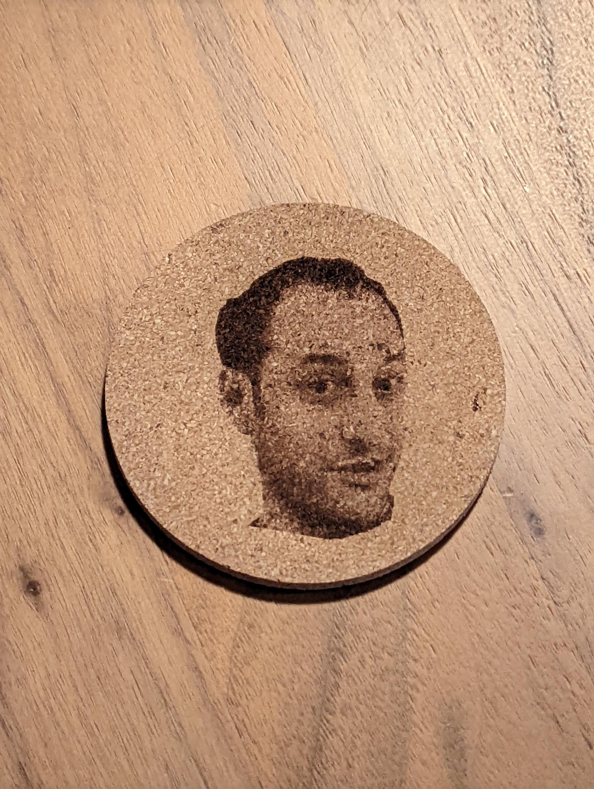

# Amy Econ Coasters

Coasters made for Amy and Econ's house.

This started as a joke gift for Amy's birthday (giving her a set of  coasters featuring Econ's face) but then she liked them and wanted more.

I used 90mm diameter, 3mm thick cork coasters from AliExpress: <https://www.aliexpress.com/item/1005007321819470.html>

Related project: <https://github.com/PhilboBaggins/econ-head>

## Images

| Amy                              | Benno                              | Dudley                              | Econ                                                          | Piggy                              |
|----------------------------------|------------------------------------|-------------------------------------|---------------------------------------------------------------|------------------------------------|
| Photo of Amy coaster coming soon | Photo of Benno coaster coming soon | Photo of Dudley coaster coming soon |  | Photo of Piggy coaster coming soon |

The [Econ/Media](./Econ/Media/) directory contains more photos and a video of the Econ coasters.

## Development method

The original Econ photo was taken from the [econ-head](https://github.com/PhilboBaggins/econ-head) project and the others were provided by Amy.

After that the images were cropped and had their backgrounds removed to prepare them for engraving into the coasters.

The images were set up for engraving in LightBurn. The settings were chosen for use with a Mr Carve M3 laser engraver. Other lasers may require different settings.

The blue line in each LightBurn file indicates the outline of the coaster and can be used as a guide for positioning the coaster correctly before engraving. It should not be engraved.
